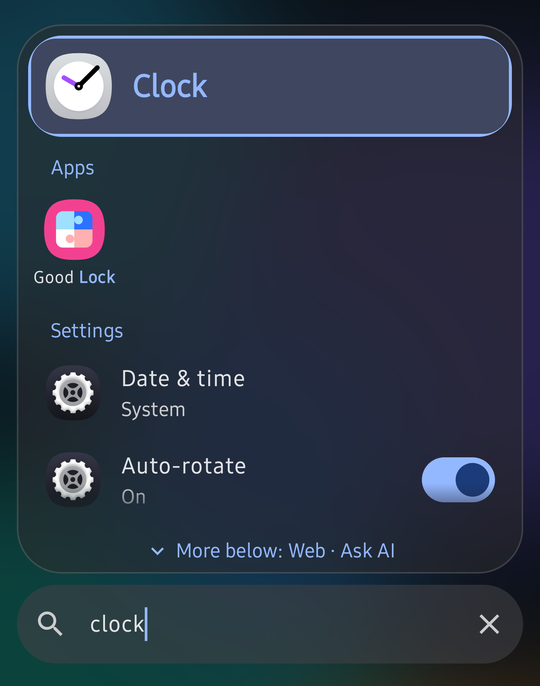
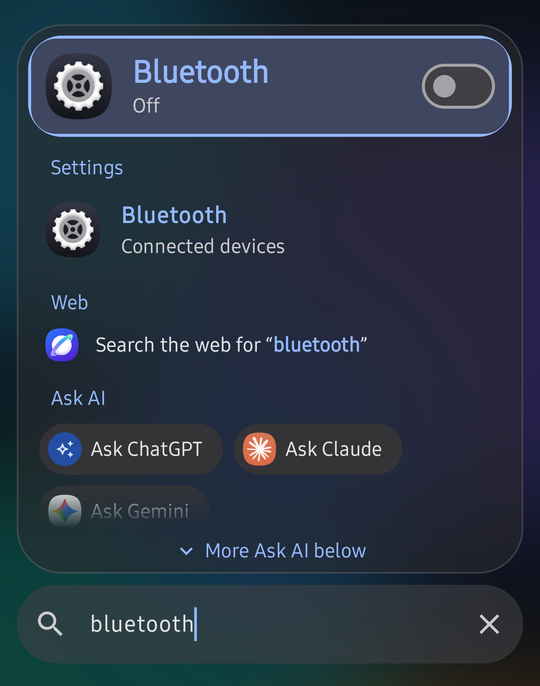
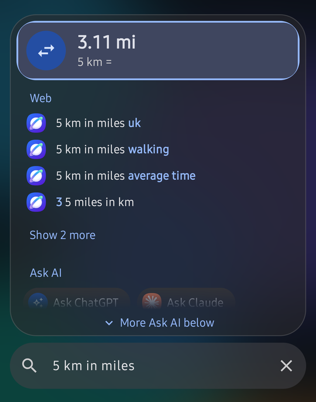
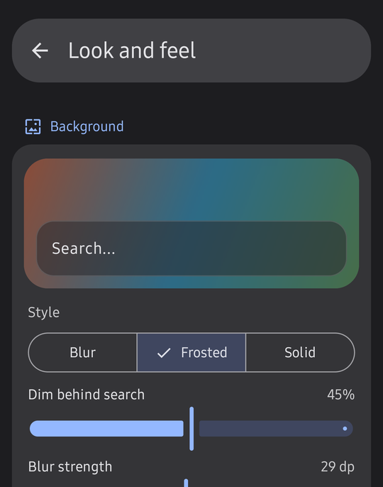
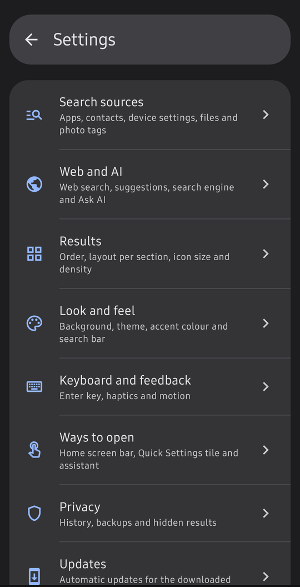

  

<h1 align="center">ekQuickFind</h1>

  <b>⚡ Find anything on your phone in a keystroke.</b> 
  Apps, contacts, calendar, settings, files, quick answers and the web, in one fast, private search bar for Android.

  
  
  
  
  
  

  <a href="#-highlights">Highlights</a> •
  <a href="#-whats-new">What's new</a> •
  <a href="#-features">Features</a> •
  <a href="#-private-by-design">Privacy</a> •
  <a href="#-get-it">Get it</a> •
  <a href="#-tips">Tips</a> •
  <a href="#-for-developers">Developers</a>

  
  &nbsp;
  
  &nbsp;
  
  &nbsp;
  

---

## 📦 Get it

| | |
| --- | --- |
| ⬇️ **Direct download** | Grab the latest APK from [Releases](https://github.com/enizvk/ekQuickFind/releases/latest). This version keeps itself up to date: it checks once a day on Wi-Fi and installs new versions after you allow it once. |

Requires Android 17 or newer. ekQuickFind is free and open source. 💚

--- 

## ✨ Highlights

Spotlight made "just type it" the fastest way around a Mac. ekQuickFind brings that to Android: open it, type two or three letters and the thing you want is already selected. Press Enter and it opens. 🚀

<table>
  <tr>
    <td width="33%" valign="top">
      <h3>🔎 One bar for everything</h3>
      Apps (work profile too), contacts, calendar events, device settings, photos, music, documents and the web.
    </td>
    <td width="33%" valign="top">
      <h3>🎛️ Flip switches in place</h3>
      Bluetooth, Wi-Fi, Do Not Disturb, auto-rotate and the flashlight show their live state and toggle right in the results.
    </td>
    <td width="33%" valign="top">
      <h3>🧠 Knows what you need</h3>
      Smart suggestions learn what you open at this time of day, or with your headphones or car connected. On the phone only.
    </td>
  </tr>
  <tr>
    <td valign="top">
      <h3>📸 Photos by what's in them</h3>
      Search "dog", "beach" or "pizza". Photos are tagged on your phone, and keywords saved in them count too.
    </td>
    <td valign="top">
      <h3>🧮 Answers as you type</h3>
      <code>12*7+5</code> or <code>5 km in miles</code> are answered before you finish typing.
    </td>
    <td valign="top">
      <h3>🤖 Ask AI in one tap</h3>
      Hand what you typed to ChatGPT, Claude or Gemini straight from the results.
    </td>
  </tr>
  <tr>
    <td valign="top">
      <h3>📅 What's next</h3>
      The meeting happening now or later today is waiting before you type a single letter.
    </td>
    <td valign="top">
      <h3>🎨 Looks the way you like</h3>
      Frosted glass, gentle glows, five fonts, a text size slider, ten accents and Material You colours.
    </td>
    <td valign="top">
      <h3>🫧 Opens from anywhere</h3>
      A floating button, the home screen widget, a Quick Settings tile, the assistant gesture or the app icon.
    </td>
  </tr>
</table>

## 🆕 What's new

- 📅 **Calendar search** finds events by title or place, and a **Next up** card shows the event happening now or in the next 12 hours.
- 🧠 **Smart suggestions** before you type: what you usually open at this hour, or with the headphones or car that are connected.
- 📋 **Clipboard chip**: copied a link or a number? Tap the chip to search it, open the link, call the number or share it, and swipe back through the last 10 clips you opened this week. The clipboard is only read when you tap.
- 🔤 **Text size and fonts**: a size slider plus Lora, JetBrains Mono, Roboto Condensed and Nunito, built into the app so they work with any system font style.
- 🌟 **Active item styles and animations**: a tinted card, soft glow or gradient highlight, and a light sweep, colour pulse, shimmer ring, breathe or twin lights on the search bar. Each one has a live preview in settings.
- 🎯 **Exact match** with one tap in the search bar, for whole words only.
- ♻️ **Reset all settings** in one tap, keeping your history, pins and hidden results.

## 🧩 Features

### 🔎 Search everything
- 📱 **Apps**, including work profile apps, with app shortcuts and uninstall/info actions
- 👤 **Contacts** with call and message buttons
- 📅 **Calendar**: events by title or place, upcoming first, with day, time and place
- ⚙️ **Device settings**: about 80 settings screens, plus live switches for Wi-Fi, Bluetooth, Do Not Disturb, auto-rotate, battery saver and the flashlight
- 🗂️ **Files and media**: photos, videos, music, and documents and downloads with All files access
- 🏷️ **Photo tags**: find photos by what's in them and by keywords saved in them, tagged on the phone in the background
- 🧮 **Quick answers**: a calculator and unit conversion for length, weight, volume, temperature, time, data and speed
- 🌐 **Web**: live suggestions from Google (default), DuckDuckGo, Bing, Brave or your own engine, plus a "Search the web" row; web search can be turned off entirely
- 🤖 **Ask AI**: hand what you typed to ChatGPT, Claude or Gemini in one tap

### 🧠 Smart results
- ✍️ Typo-tolerant matching that highlights the letters that matched, including initials: "gm" finds Google Maps
- 🎯 An exact-match button in the search bar for whole words only (and a switch to hide it)
- ⏎ The best match is selected, so Enter opens it; arrow keys move the selection on a hardware keyboard
- 📈 Results you open rank higher over time
- 📌 Pin favourites, hide results and exclude apps
- 🕘 Recently opened items as a list or a strip of chips, as many as you like (5 by default, up to 20)
- 💡 Smart suggestions, Next up and a Clipboard chip before you type, each with its own switch
- 👇 "More below" names the sections that are still out of view

### 🎨 Make it yours
- 🧱 Sections you can reorder by dragging, each shown as rows, a compact grid or chips
- 🔠 A text size slider, five fonts and four weights, with a live sample
- 🏆 The best match in its own section with an animated highlight, or as a big card on top
- ✨ A tinted, soft-glow or gradient highlight on the active result, with its own animation (settle, lift or a border glow)
- 🌈 A gentle animation on the search bar when it opens: light sweep, colour pulse, shimmer ring, breathe or twin lights
- 👀 Live previews next to every look option, so you see the result before leaving settings
- 👍 Search bar at the bottom or top, with the selected result kept right above it for one-handed use
- 🧊 Frosted glass, blur or solid background with adjustable dim and blur strength, including Samsung's own blur on One UI
- 🌗 Light, dark or system theme, wallpaper colours and ten accent colours
- 📳 Haptics, reduced motion and smooth Material 3 Expressive animations
- ♻️ Reset every setting to its default in one tap

### 🚪 Open it from anywhere
- 🫧 A floating button over every app: drag it anywhere and it settles on the nearest edge; size and transparency are adjustable
- 🏠 App icon, home screen search bar widget and Quick Settings tile
- 📌 Launcher shortcuts for pinned results
- 🎙️ Set it as your digital assistant, or as the system search for other apps' search buttons

### 🛡️ Private and up to date
- 🔒 Everything stays on the phone: no accounts, analytics or ads, and history is left out of backups
- 🧹 One tap clears history
- 🔄 The direct-download version checks GitHub once a day and updates itself

## ⚙️ Settings

Everything above is configurable, grouped into pages like the system Settings app.

  

## 🔒 Private by design

- 🏠 History, pins and settings stay on your phone. No accounts, no analytics, no ads.
- 🌐 Only web suggestions and the daily update check (direct-download version) use the network. Both can be turned off, and web search can be switched off entirely.
- 📸 Photo tags are worked out on the phone; no photo ever leaves it.
- 🧠 Smart suggestions are learned from your own history, on the phone.
- 📋 The clipboard is only read when you tap the Clipboard chip. The clips you open are kept on the phone for 7 days, never in backups, and Clear history removes them. Text Android marks as sensitive, like passwords, is never read or kept.
- ☁️ History is left out of cloud backups unless you turn that on.

## 💡 Tips

- ⚡ **Faster than the icon:** add the Quick Settings tile or the home screen search bar from *Settings > Ways to open*.
- 👍 **One-handed:** turn on *Selected result by the search bar* so the best match sits right above the keyboard.
- 📋 **Copied an address?** Open search and tap the Clipboard chip to open it or search it.
- 🚗 **In the car:** open the same music or maps app a couple of times with the car connected, and it's suggested every time you're back in the car.
- 📱 **Samsung:** set the side button double press to open ekQuickFind (*Settings > Advanced features > Side button*).

## 🛠️ For developers

ekQuickFind is written in Kotlin with Jetpack Compose, Hilt, Room, DataStore and WorkManager, split into a pure-Kotlin search engine and Android modules. See [docs/development.md](docs/development.md) for building and testing, and [docs/updates.md](docs/updates.md) for publishing a direct-download release.

## 📄 License

Copyright 2026 ekQuickFind contributors.

Licensed under the [Apache License, Version 2.0](LICENSE). You may use, change and share the code, including in other projects, as long as you keep the license and notices.

Photo tags use [Google ML Kit](https://developers.google.com/ml-kit) image labelling (and the Google support libraries it brings with it). It runs on the phone, but Google distributes it under its own [terms](https://developers.google.com/ml-kit/terms) rather than an open-source license. ekQuickFind's other libraries are open source. The result fonts Lora, JetBrains Mono, Roboto Condensed and Nunito are bundled under the [SIL Open Font License 1.1](app/src/main/assets/licenses/fonts).
